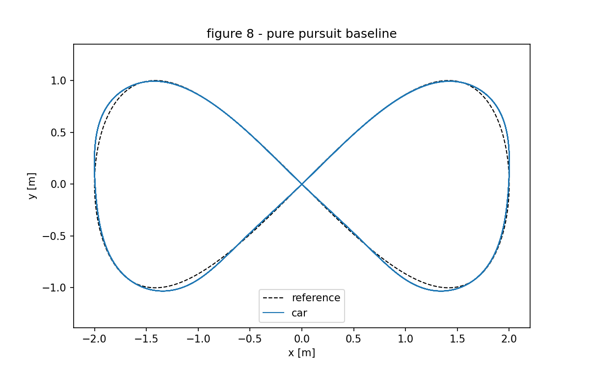
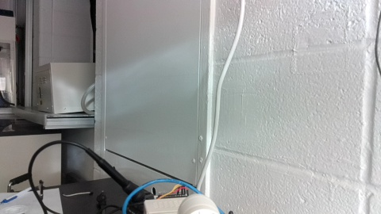

# NCL Car Testbed

Testbed for comparing path-tracking controllers on the Nonlinear Controls Lab (NCL) autonomous RC car.

## car testbed log

### 11/23

got the repo up + a first figure 8 sim working. no car access yet so sim only for now

setup:
- kinematic bicycle model, 100hz
- pure pursuit for steering (lookahead 0.5m), PI on speed, target 1.5 m/s
- added servo lag (0.1s) + simple force/drag model for speed so its not totally ideal
- figure 8 = lemniscate of gerono, A = 2m, lap is about 12.2m

pure pursuit part is basically just this:
```python
alpha = np.arctan2(py[g] - y, px[g] - x) - th
delta_cmd = np.arctan2(2*L*np.sin(alpha), LOOKAHEAD)
```
where g is the path point 0.5m ahead (by arc length) of the closest point.
had to only search near the last index for the closest point otherwise it
jumps to the other branch at the crossing in the middle

result: around 2.1cm rms cross track error per lap
```
lap  rms [cm]
1    2.063
2    2.133
3    2.13
...
8    2.119
```
basically the same every lap. its cutting the 4 outer corners the same way each time
which is good bc thats exactly what ILC should be able to learn out

tried adding 1kg mid run (lap 5) -- no change at all. speed loop absorbs it and steering
doesnt depend on mass in this model. so for the ILC disturbance test it has to be something
on the steering side (steering gain change or a side push), not mass



todo / notes
- wheelbase (0.3) and mass (2.5) are guesses, need to measure on the car
- tue: car account, back up sd card, hardware audit
- by wed: ILC on top of this + lateral disturbance

### 11/24

goals:
- fix perms on car
- get pictures from car cam
- get car moving at all

**perms** -- couldnt get into the old student's stuff at first (permission denied).
beigi copied all of it into my user so thats sorted now. backed up the whole home folder too

**went through the old code** -- big thing: the car is NOT a steered rc car, its a 4 wheel
diff drive (skid steer), no servo. turns by running left/right wheels at diff speeds.
ROS 2 humble + ros2_control, 30 hz loop, wheel PIDs, max ~0.9-1.0 m/s.
also found an old self tuning regulator (RLS w/ forgetting factor) + LSTR.m from the last student,
only ever ran on a sim inverted pendulum though

**car cam** -- OAK-D Lite works, 30 fps. wrote a little script that starts the camera and
streams it to my laptop browser:
```bash
~/mihir_ncl/stream_video/run.sh   # prints a link, ctrl+c to stop
```



**moving** -- got the wheels spinning with the car up on a box. havent driven it on the floor yet

**sim** -- switched from bicycle model to diff drive since theres no steering:
```python
w_cmd = 2*VREF*np.sin(alpha)/LOOKAHEAD   # pure pursuit -> turn rate
vl_cmd = VREF - w_cmd*B/2
vr_cmd = VREF + w_cmd*B/2
```
30 hz (same as the car), 0.7 m/s. baseline now ~1.54 cm rms per lap, still the same every lap

todo
- measure wheel separation (config says 0.24m but a comment says 125mm) + wheel radius + mass
- drive it on the floor
